# KickHub

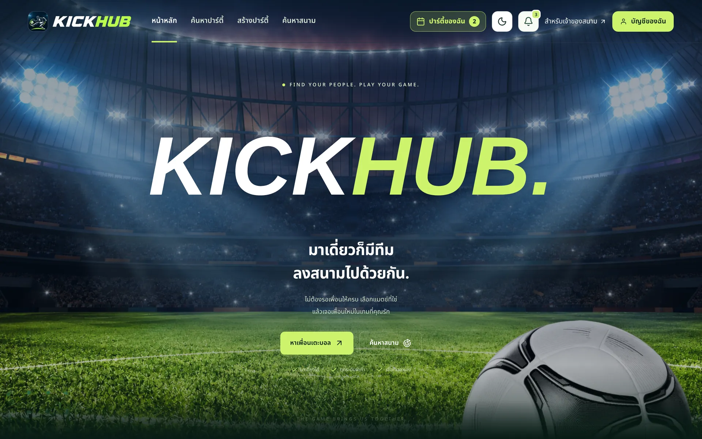

KickHub เป็นเว็บสำหรับคนที่อยากหาเพื่อนเตะฟุตบอล และคนที่ดูแลสนามฟุตบอล ผู้เล่นสามารถค้นหาปาร์ตี้ที่กำลังเปิดรับ ดูรายละเอียดทีม และส่งคำขอเข้าร่วมได้ ส่วนหัวตี้จัดการสมาชิกและคำขอได้ในที่เดียว เจ้าของสนามก็สามารถลงข้อมูลสนามของตัวเองได้

โปรเจกต์นี้ทำขึ้นเพื่อฝึกพัฒนาเว็บแบบ Full-stack โดยมีทั้งหน้าเว็บ API และฐานข้อมูลจริง KickHub ช่วยรวมคนให้ครบทีม แต่ไม่รับจองสนามหรือรับชำระเงิน ผู้เล่นยังต้องติดต่อสนามเพื่อยืนยันการจองเอง

## ภาพหน้าจอ

ภาพทั้งหมดถ่ายจากเว็บที่ build จริง ขนาดจอ iPhone (390 px) โดยใช้ข้อมูลตัวอย่าง ชื่อผู้เล่นและแชตในภาพเป็นข้อมูลสมมติ

| ค้นหาปาร์ตี้ | รายละเอียดปาร์ตี้ | แชตในทีม | หัวตี้อนุมัติคำขอ |
| :---: | :---: | :---: | :---: |
| 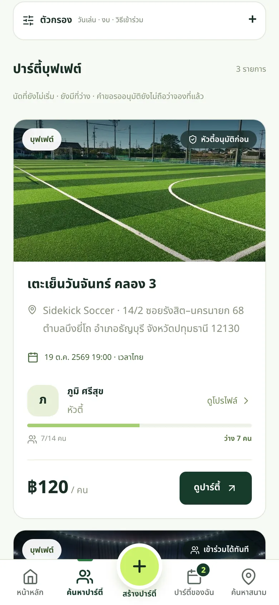 | 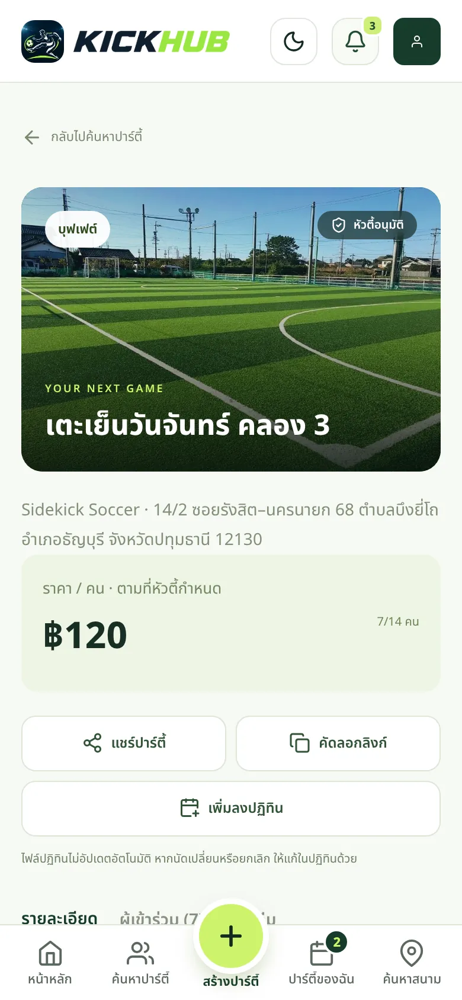 | 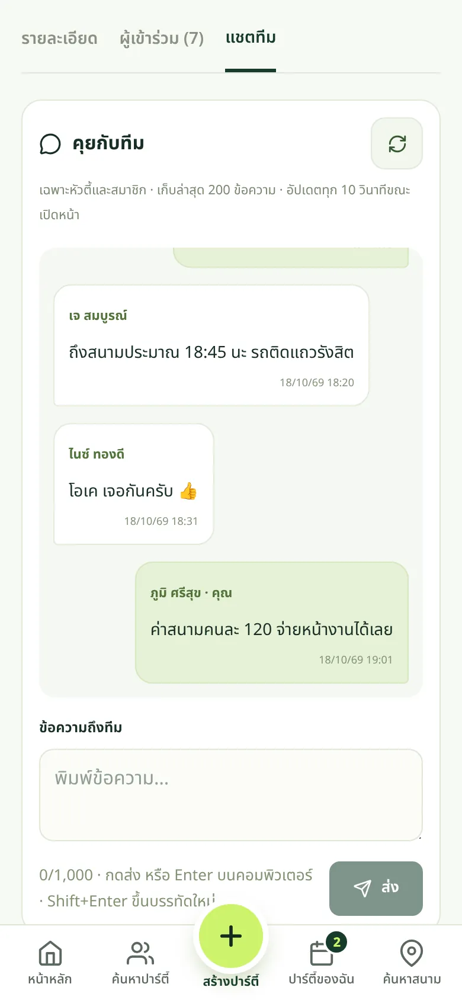 | 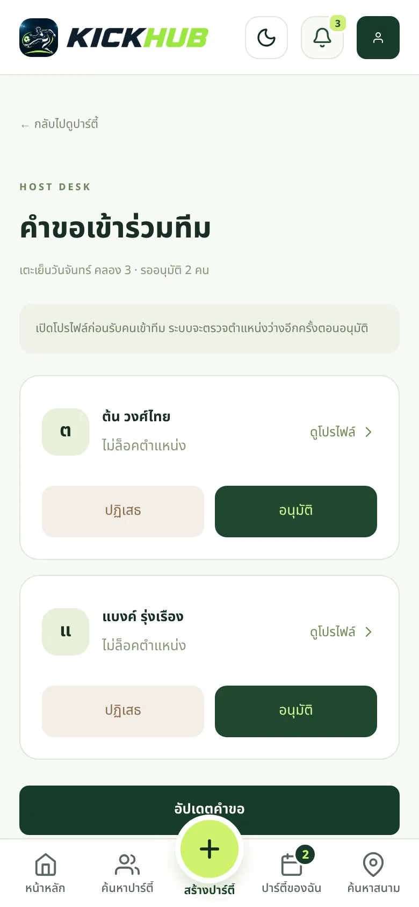 |

| สร้างปาร์ตี้ | รายละเอียดสนาม | ปาร์ตี้ของฉัน | การแจ้งเตือน |
| :---: | :---: | :---: | :---: |
| 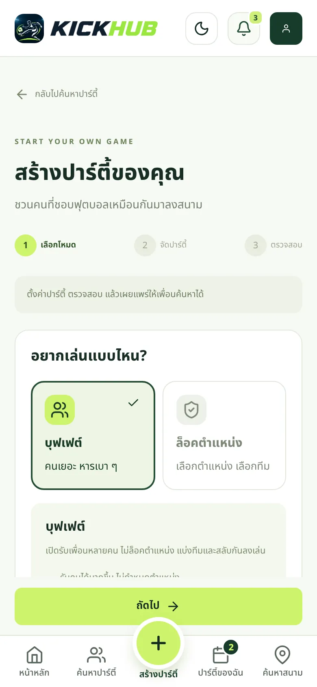 | 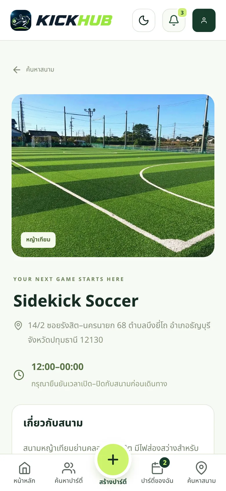 | 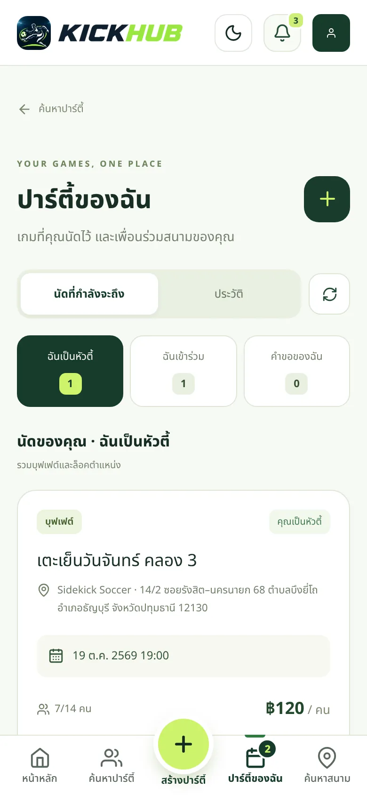 | 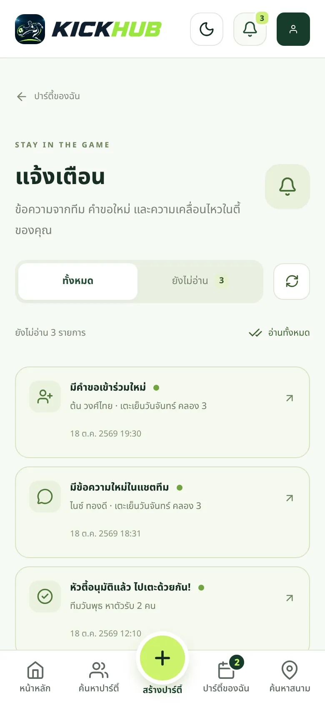 |

| โปรไฟล์ | แดชบอร์ดเจ้าของสนาม | เข้าสู่ระบบ | Dark mode |
| :---: | :---: | :---: | :---: |
| 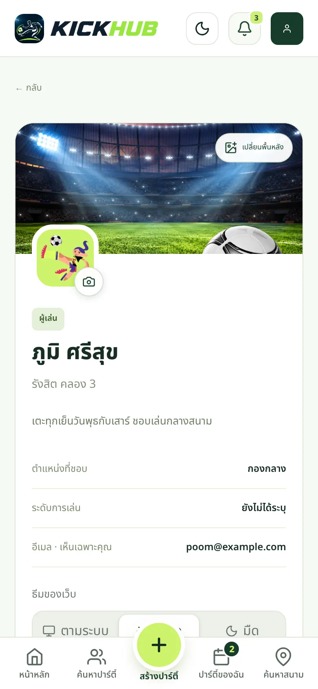 | 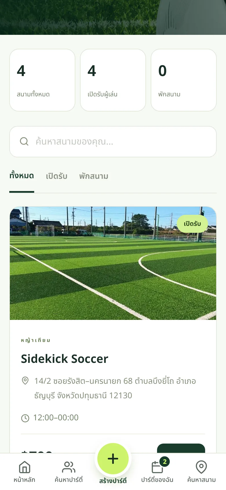 | 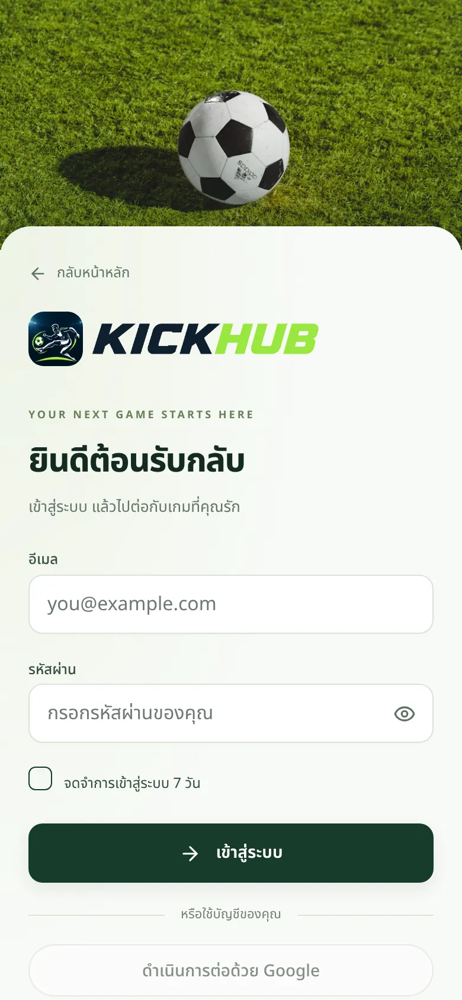 | 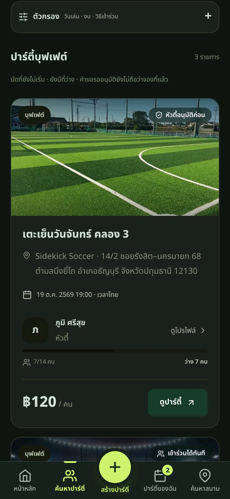 |

## ฟีเจอร์หลัก

- **ค้นหาปาร์ตี้**: ค้นหาตามชื่อ สนาม วันที่ งบประมาณ และรูปแบบการเล่น
- **สร้างปาร์ตี้**: เลือกสนาม เวลา จำนวนผู้เล่น และราคาต่อคน
- **เลือกวิธีเล่น**: แบบบุฟเฟต์ที่ไม่ล็อกตำแหน่ง หรือแบบเลือกตำแหน่ง GK, DF, MF และ FW
- **จัดการคำขอ**: หัวตี้อนุมัติหรือปฏิเสธคำขอได้ ส่วนผู้เล่นดูสถานะและยกเลิกคำขอได้
- **โปรไฟล์ผู้เล่น**: ดูและแก้ไขข้อมูลโปรไฟล์ของตัวเอง อัปโหลดรูปโปรไฟล์และรูปปก หรือใช้รูปจากบัญชี Google/Facebook
- **รูปปกปาร์ตี้**: หัวตี้ใส่รูปปกให้ปาร์ตี้ได้ รูปขึ้นทั้งในการ์ดค้นหาและหน้ารายละเอียด
- **แชตและการแจ้งเตือน**: สมาชิกที่เข้าร่วมแล้วคุยกันในแชตของปาร์ตี้ และติดตามกิจกรรมภายในเว็บ
- **ค้นหาสนาม**: ดูข้อมูลสนามและหน้ารายละเอียดสนาม
- **สำหรับเจ้าของสนาม**: เพิ่มและจัดการข้อมูลสนามที่ตัวเองดูแล เปิดหรือพักสนามได้
- **เข้าสู่ระบบ**: รองรับอีเมลและรหัสผ่าน พร้อมตัวเลือก Google/Facebook เมื่อกำหนดค่าไว้
- **ลบบัญชี**: ผู้ใช้ลบบัญชีและข้อมูลที่ผูกกับบัญชีได้เอง พร้อมหน้า Privacy, Terms และ Data Deletion
- **ใช้งานบนมือถือ**: หน้าจอปรับตามขนาดอุปกรณ์ มีแถบเมนูล่างบนมือถือ และเลือกธีมสว่าง มืด หรือตามระบบได้

## เทคโนโลยี

- Frontend: React 19, Vite, TypeScript/JavaScript, Tailwind CSS 4 และ React Router 7
- Backend: Node.js 22, Express 5
- Database: MongoDB และ Mongoose 8
- Authentication: JWT; Google Identity Services และ Facebook Login เป็นตัวเลือกเสริม
- Deploy: Render (API + Static Site) คู่กับ MongoDB Atlas, ตรวจโค้ดด้วย GitHub Actions

## เริ่มใช้งานบนเครื่องตัวเอง

### สิ่งที่ต้องมี

- Node.js 20.19 ขึ้นไป (แนะนำ Node.js 22)
- MongoDB ที่รันในเครื่อง หรือ MongoDB Atlas
- npm

### 1. ตั้งค่า Backend

คัดลอกไฟล์ `Backend/.env.example` เป็น `Backend/.env` แล้วกำหนดค่าตามตัวอย่างนี้ ค่าที่ขาดไม่ได้คือ `SECRET_KEY` เพราะ API จะไม่ยอมเริ่มทำงานถ้าไม่มี ส่วนค่าอื่นมีค่าเริ่มต้นตรงกับตัวอย่างอยู่แล้ว:

```env
MONGODB_URI=mongodb://127.0.0.1:27017/kickhub
SECRET_KEY=ใส่ค่าสุ่มที่ยาวและคาดเดายาก
PORT=3000
CLIENT_ORIGIN=http://localhost:5173
```

เปิด MongoDB ก่อน หากใช้ฐานข้อมูลในเครื่อง จากนั้นเปิด Terminal ที่โฟลเดอร์โปรเจกต์แล้วรัน:

```bash
cd Backend
npm ci
npm run dev
```

ถ้าเห็นข้อความ `KickHub API ready` แปลว่า API พร้อมแล้ว ลองเปิด `http://localhost:3000/api/health` ต้องได้ `{"status":"ok"}`

#### MongoDB ในเครื่องกับการลบบัญชี

ฟีเจอร์ลบบัญชี (`/account/delete`) ใช้ MongoDB transaction เพื่อลบข้อมูลทุกส่วนพร้อมกันหรือไม่ลบเลย transaction ทำงานได้เฉพาะ replica set ถ้าคุณรัน `mongod` แบบปกติ (standalone) ฟีเจอร์อื่นใช้ได้ครบ แต่การลบบัญชีจะล้มเหลว MongoDB Atlas เป็น replica set อยู่แล้วจึงไม่มีปัญหานี้

ถ้าต้องการทดสอบการลบบัญชีในเครื่อง ให้เปิด MongoDB เป็น replica set แบบเครื่องเดียว:

```bash
mongod --replSet rs0 --dbpath <โฟลเดอร์ข้อมูล>
mongosh --eval "rs.initiate()"
```

แล้วตั้ง `MONGODB_URI=mongodb://127.0.0.1:27017/kickhub?replicaSet=rs0`

#### ข้อมูลตั้งต้น (ไม่บังคับ)

ฐานข้อมูลใหม่จะว่างเปล่า ถ้าอยากได้บัญชีเจ้าของสนามพร้อมสนามตัวอย่างจาก `Backend/data/initial-fields.json` ให้รัน:

```bash
cd Backend
npm run db:reset -- --confirm=kickhub
```

สคริปต์จะถามชื่อและอีเมลของบัญชีเจ้าของสนาม แล้วพิมพ์รหัสผ่านสุ่มออกมาครั้งเดียว ให้จดเก็บไว้ คำสั่งนี้**ลบข้อมูลทั้งหมด**ในฐานข้อมูล `kickhub` หลังสำรองไฟล์ไว้ที่โฟลเดอร์ `.backups/` และยอมทำงานเฉพาะเมื่อ `MONGODB_URI` ชี้ไปที่ `localhost` หรือ `127.0.0.1` กับฐานข้อมูลชื่อ `kickhub` ห้ามใช้กับฐานข้อมูลออนไลน์

### 2. ตั้งค่า Frontend

เปิด Terminal อีกหน้าต่าง แล้วรัน:

```bash
cd frontend
npm ci
npm run dev
```

เปิด URL ที่ Vite แสดงใน Terminal โดยปกติจะเป็น `http://localhost:5173`

ในโหมดพัฒนา Frontend จะส่งคำขอ `/api` ไปยัง Backend ที่พอร์ต 3000 ผ่าน Vite proxy หากใช้โดเมนหรือพอร์ตอื่น ให้ตรวจการตั้งค่าใน `frontend/.env.example` และตั้ง `CLIENT_ORIGIN` ใน Backend ให้ตรงกับที่ใช้งานจริง

## วิธีลองใช้งาน

1. สมัครบัญชีผู้เล่นเพื่อค้นหาปาร์ตี้หรือส่งคำขอเข้าร่วม
2. สร้างบัญชีเจ้าของสนาม แล้วเพิ่มข้อมูลสนามผ่านหน้าเจ้าของสนาม หากฐานข้อมูลยังไม่มีสนาม
3. สร้างปาร์ตี้ เลือกรูปแบบการเล่น วันเวลา จำนวนคน และราคาต่อคน
4. เปิดหน้ารายละเอียดปาร์ตี้เพื่อดูสมาชิกและจัดการการเข้าร่วม
5. ใช้หน้าโปรไฟล์ ปาร์ตี้ของฉัน และการแจ้งเตือนเพื่อติดตามกิจกรรม

## หน้าที่ใช้บ่อย

| หน้า | ใช้ทำอะไร |
| --- | --- |
| `/home` | หน้าแรก |
| `/login`, `/register` | เข้าสู่ระบบและสมัครสมาชิก |
| `/team` | ค้นหาปาร์ตี้ |
| `/create-party` | สร้างปาร์ตี้ |
| `/parties/:partyId` | ดูรายละเอียดปาร์ตี้ |
| `/party-requests/:partyId` | จัดการคำขอสำหรับหัวตี้ |
| `/my-parties` | ดูปาร์ตี้ที่จัด เข้าร่วม หรือส่งคำขอไว้ |
| `/field`, `/fields/:fieldId` | ค้นหาและดูรายละเอียดสนาม |
| `/profile` | โปรไฟล์ของตัวเอง |
| `/players/:playerId` | โปรไฟล์สาธารณะของผู้เล่นคนอื่น |
| `/notifications` | การแจ้งเตือน |
| `/Owner` | จัดการสนามสำหรับเจ้าของสนาม |
| `/account/delete` | ลบบัญชีของตัวเอง (ต้องเข้าสู่ระบบภายใน 10 นาทีล่าสุด) |
| `/privacy`, `/terms`, `/data-deletion` | นโยบายความเป็นส่วนตัว ข้อกำหนด และวิธีขอลบข้อมูล ซึ่ง Facebook Login ใช้ตรวจสอบ |

ยังมีหน้า `/demo/*` สำหรับข้อมูลตัวอย่าง ซึ่งไม่ใช่เส้นทางหลักของการใช้งานปัจจุบัน

## โครงสร้างโปรเจกต์

```text
kickhub/
├── Backend/                 API (Express + Mongoose)
│   ├── server.js            ตรวจค่า .env เชื่อมฐานข้อมูล แล้วเปิดพอร์ต
│   ├── app.js               รวม route, CORS, rate limit และตัวจัดการ error
│   ├── routes/              endpoint แยกตามกลุ่ม
│   ├── services/            logic ของปาร์ตี้ คำขอ แชต แจ้งเตือน รูปภาพ และการลบบัญชี
│   ├── models/              Mongoose schema (User, Field, Post = ปาร์ตี้, Reservation, รูปภาพ)
│   ├── data/                ข้อมูลสนามตั้งต้นและรูปสนาม
│   ├── scripts/             reset-data.js สำหรับล้างและเติมข้อมูลในเครื่อง
│   └── test/                unit test และ integration test
├── frontend/                เว็บ (React + Vite)
│   ├── src/features/        หน้าจอแยกตามเรื่อง: live (ปาร์ตี้ แชต แจ้งเตือน), fields, parties, profiles, owner, policies
│   ├── src/lib/api.ts       ตัวเรียก API และแนบ token
│   ├── scripts/             render-policies.mjs สร้างไฟล์ HTML ของหน้านโยบายตอน build
│   └── test/                test ของ helper ฝั่งเว็บ
├── render.yaml              Blueprint สำหรับ deploy บน Render
└── .github/workflows/ci.yml ตรวจ lint, test และ build ทุก pull request
```

## กลุ่ม API

| Path | ใช้ทำอะไร |
| --- | --- |
| `GET /api/health` | ตรวจว่า API ต่อฐานข้อมูลได้ (200 = พร้อม, 503 = ฐานข้อมูลหลุด) |
| `/api/auth/*` | สมัคร เข้าสู่ระบบด้วยอีเมล Google และ Facebook มี rate limit ต่อ IP |
| `/api/v2/*` | ปาร์ตี้ คำขอเข้าร่วม แชต แจ้งเตือน โปรไฟล์ และข้อมูลสนามฝั่งผู้เล่น |
| `/api/add-fields`, `/api/owner-fields`, `/api/update-fields/:id`, `/api/delete-fields/:id` | จัดการสนาม ใช้ได้เฉพาะบัญชี role `owner` และแก้ได้เฉพาะสนามของตัวเอง |
| `DELETE /api/account` | ลบบัญชีและข้อมูลที่ผูกกับบัญชี |

route ที่ต้องเข้าสู่ระบบรับ JWT ผ่าน header `Authorization: Bearer <token>`

## การทำงานเบื้องหลังที่ควรรู้

- **รูปภาพเก็บใน MongoDB** รูปโปรไฟล์ รูปปก และรูปปาร์ตี้ถูกเก็บเป็นข้อมูลไบนารีในฐานข้อมูล (`ProfileImage`, `PartyImage`) จึงไม่ต้องตั้งค่าบริการเก็บไฟล์เพิ่ม รับเฉพาะ JPG, PNG, WebP ขนาดไม่เกิน 2 MB
- **แชตและแจ้งเตือนใช้ polling** หน้าแชตดึงข้อความใหม่ทุก 10 วินาที กระดิ่งแจ้งเตือนดึงทุก 15 วินาที ไม่มี WebSocket หรือ push notification ผู้ใช้จะเห็นข้อความใหม่เมื่อเปิดหน้าเว็บค้างไว้เท่านั้น
- **รูปสนามจาก directory** ทุกครั้งที่ API เริ่มทำงาน ระบบจะเติมรูปให้สนามที่นำเข้ามาและยังไม่มีเจ้าของ โดยใช้รายการใน `Backend/data/directory-field-photos.json` รูปที่เจ้าของสนามอัปโหลดเองจะไม่ถูกเขียนทับ

## การทดสอบ

```bash
# Backend
cd Backend
npm test                  # unit test ไม่ต้องใช้ฐานข้อมูล
npm run test:integration  # ทดสอบ API กับ MongoDB จริง

# Frontend
cd frontend
npm run lint
npm test
npm run build             # รวม typecheck ด้วย
```

`test:integration` ใช้ `mongodb-memory-server` ซึ่งดาวน์โหลด MongoDB 7.0.24 ในการรันครั้งแรก เครื่องต้องต่ออินเทอร์เน็ตได้ ถ้าต้องการใช้ MongoDB ในเครื่องแทนสำหรับ `parties.test.js` ให้ตั้ง `TEST_MONGODB_URI=mongodb://127.0.0.1:27017/kickhub_test` ชุดทดสอบจะลบฐานข้อมูลนี้ทุกครั้ง จึงยอมรับเฉพาะชื่อ `kickhub_test` บน localhost ส่วนชุดทดสอบการลบบัญชีใช้ replica set ในหน่วยความจำเสมอ

GitHub Actions รันทุกคำสั่งข้างบนเมื่อ push เข้า `main` และเมื่อเปิด pull request

ผลล่าสุดที่ commit `1d72cae` (18 ต.ค. 2026): Backend unit test ผ่าน 79 ข้อ Frontend test ผ่าน 22 ข้อ และ `npm run build` สำเร็จ

## สถานะโปรเจกต์

เริ่มพัฒนาเมื่อ 10 ต.ค. 2026 งานแต่ละชิ้นเข้า `main` ผ่าน pull request

| ช่วง | สิ่งที่ทำ |
| --- | --- |
| 10–11 ต.ค. | วางหน้าค้นหาปาร์ตี้และ hero หน้าแรก ต่อ flow ปาร์ตี้กับ MongoDB ทำแดชบอร์ดเจ้าของสนาม และสคริปต์ล้างข้อมูลในเครื่อง |
| 12–13 ต.ค. | รูปโปรไฟล์และรูปปก dark mode แก้ไขโปรไฟล์ รูปปกปาร์ตี้ ทางลัดปาร์ตี้ของฉัน และแก้ layout บน iPad/มือถือ |
| 17–18 ต.ค. | ปิด API การจองที่เปิดค้างไว้ เพิ่ม rate limit ที่หน้าเข้าสู่ระบบ ลบหน้าเก่าที่เข้าไม่ถึง ให้ CI รัน lint ปรับ README และเปลี่ยนโลโก้แบรนด์ใหม่ |

### งานที่ยังค้าง

- ทดสอบบน iPhone, Android และ Google/Facebook Login กับเว็บที่ deploy จริงตามขั้นตอนใน [DEPLOYMENT.md](./DEPLOYMENT.md) ชุดทดสอบในเครื่องยังไม่ครอบคลุมส่วนนี้
- แชตและแจ้งเตือนยังใช้ polling ถ้าต้องการให้ผู้ใช้รู้ตัวตอนปิดเว็บ ต้องเพิ่ม WebSocket หรือ push notification
- `frontend/package.json` ยังมี package ที่โค้ดใน `src/` ไม่ได้ import เลย ได้แก่ `@mui/material`, `@mui/x-date-pickers`, `@emotion/react`, `@emotion/styled`, `styled-components`, `jwt-decode` และ `@tailwindcss/line-clamp` ลบออกได้เพื่อให้ติดตั้งเร็วขึ้น
- หน้า `/demo/*` ใช้ข้อมูลตัวอย่างและไม่ได้ต่อ API แล้ว ควรเลือกว่าจะเก็บไว้หรือลบ

## หมายเหตุ

- การสร้างปาร์ตี้ใน KickHub **ไม่ได้เป็นการจองสนามหรือชำระเงิน** ผู้ใช้ยังต้องติดต่อสนามเพื่อยืนยันการจองด้วยตัวเอง
- Google Login และ Facebook Login ต้องตั้งค่า Client/App ID และข้อมูลที่เกี่ยวข้องใน `Backend/.env` ก่อน หากยังไม่ได้ตั้งค่า สามารถใช้การสมัครและเข้าสู่ระบบด้วยอีเมลได้
- อย่านำไฟล์ `.env` หรือคีย์ลับขึ้น GitHub
- คู่มือการ Deploy และการตั้งค่าเพิ่มเติมอยู่ใน [DEPLOYMENT.md](./DEPLOYMENT.md)

---

โปรเจกต์นี้เป็นงานพัฒนาต่อเนื่อง หากพบปัญหาหรือมีข้อเสนอแนะ สามารถเปิด Issue ใน Repository ได้
